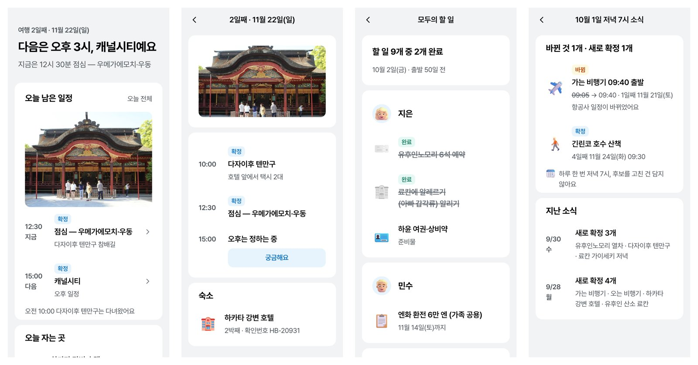
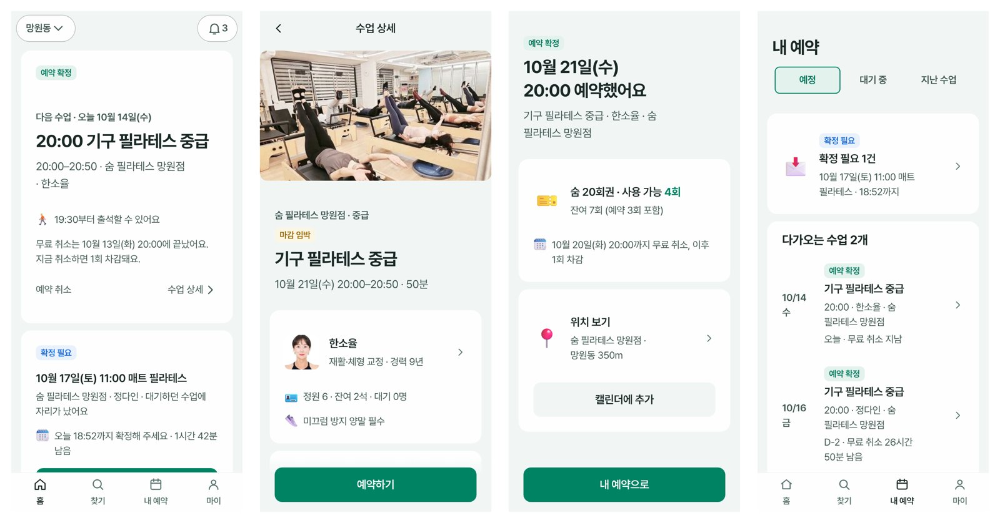
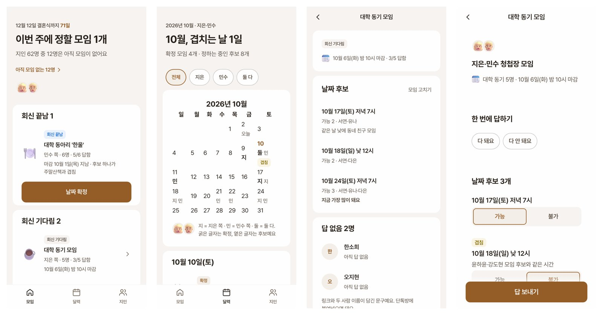
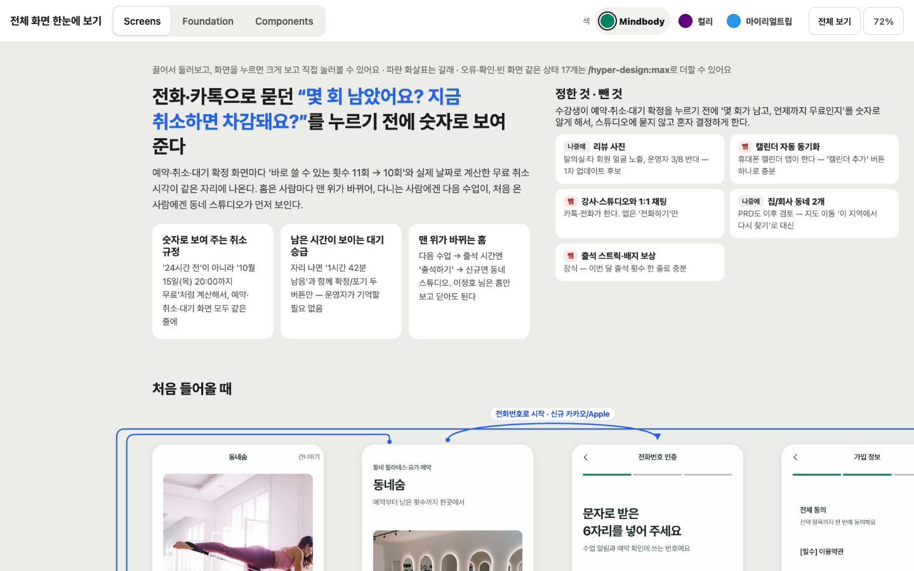

# k-style-ui-ux

PRD(기획 문서) 한 장을 넣으면 **한국 앱 스타일의 모바일 화면 초안**을 15분 안팎에 HTML로 뽑아 주는 Claude Code·Codex·Cursor 플러그인입니다. [VIBE MAFIA CLUB 이너서클](https://www.vibemafiaclub.com/inner-circle)이 함께 만드는 오픈소스입니다.



## 이런 분께 맞습니다

- **디자이너 없이 초기 앱을 만드는 분** — 외주를 맡기기 전에 화면 흐름과 첫 초안을 먼저 받아 볼 수 있습니다.
- **사내 도구처럼 기획·디자인까지 직접 해야 하는 개발자**
- **디자이너** — 같은 작업의 첫 초안을 빨리 받고 다듬는 데 쓸 수 있습니다.

완제품을 대신 만드는 도구는 아닙니다. 초안을 빨리 만들어 병목을 없애는 도구이고, 디테일·미감·문구는 여전히 사람이 잡아야 합니다.

## 무엇이 다른가

- **UX 먼저** — 화려한 화면보다 핵심 기능에 헤매지 않고 닿는지를 먼저 봅니다. 사용자가 만들거나 신청하는 모든 대상마다 시작 → 보기 → 고치기 → 끝(결과) 화면을 빠짐없이 만듭니다.
- **한국 서비스 기준** — 29CM·에어비앤비·클래스101·당근·컬리·무신사·마이리얼트립 등 국내 서비스에서 수집한 색 팔레트 중에서 고르고, 결과물에서 팔레트 3벌을 원클릭으로 바꿔 볼 수 있습니다. 여백·글자 크기 같은 값과 아이콘([Fluent Emoji](https://github.com/microsoft/fluentui-emoji), MIT)은 미리 준비돼 있습니다.
- **검사 후 전달** — 토큰·부품 사용과 빠진 화면, 한국어 줄바꿈(어절 쪼개짐·칸 넘침, [hangul-wrap](https://github.com/hanmariyang/giting-skills)의 실측 방식, MIT)은 스크립트(`selfcheck.py`·`audit.py`)로 검사하고, 화면 캡처는 체크리스트로 비평해 P0·P1 문제를 고친 뒤 넘깁니다. 체크리스트([`core/references/checklist.md`](./plugins/k-style-ui-ux/core/references/checklist.md))는 하네스를 안 써도 참고할 만합니다.

## 예시

main 하네스(v14·v15)로 만든 화면입니다. 결과 폴더는 산출물 정리 전 커밋에 보관돼 있습니다. 받아서 `index.html`을 브라우저로 열면 캔버스에서 전체 흐름을 볼 수 있습니다.

| PRD | 결과 | 걸린 시간(당시 판본) |
|---|---|---|
| [가족여행 계획](./prd/family-trip.md) | [loop/results/v15-family-trip](https://github.com/vmc-inner-circle/k-style-ui-ux/tree/e8a96166c2631e6219f88007ffc5dc2de4e21bc4/loop/results/v15-family-trip) | 8.6분 |
| [청첩장 모임](./prd/wedding-meetup.md) | [loop/results/v15-wedding-meetup](https://github.com/vmc-inner-circle/k-style-ui-ux/tree/e8a96166c2631e6219f88007ffc5dc2de4e21bc4/loop/results/v15-wedding-meetup) | 1차 16.1분 + 2차 17.0분 |
| [필라테스 예약](./prd/pilates-booking.md) | [loop/results/v14-pilates-booking](https://github.com/vmc-inner-circle/k-style-ui-ux/tree/e8a96166c2631e6219f88007ffc5dc2de4e21bc4/loop/results/v14-pilates-booking) | 23.3분 |




캔버스(흐름별 화면·화살표·화면별 정책):



## 설치

Claude Code에서:
```
/plugin marketplace add vmc-inner-circle/k-style-ui-ux
/plugin install k-style-ui-ux@k-style-ui-ux
```
로컬에서 바로 써 보려면: `claude --plugin-dir <이 저장소>/plugins/k-style-ui-ux`

Codex에서:
```
codex plugin marketplace add vmc-inner-circle/k-style-ui-ux
codex plugin add k-style-ui-ux@k-style-ui-ux
```

Cursor에서: **Customize → Plugins**에서 GitHub 저장소로 가져오기에 `https://github.com/vmc-inner-circle/k-style-ui-ux`를 넣고 `k-style-ui-ux`를 설치합니다.

## 사용법

```
/k-style-ui-ux:go <PRD 파일 경로>   # 1차, 약 15분
/k-style-ui-ux:max                  # 2차 — 오류·확인창·빈 화면 같은 상태 화면 추가, 약 10분
```

Codex에서는 `$k-style-ui-ux:go`·`$k-style-ui-ux:max`로, Cursor에서는 채팅에 `/`를 치고 `go`·`max`를 골라 부릅니다.

PRD만 붙여넣고 "화면 만들어줘"라고 해도 됩니다. 결과는 실행한 폴더의 `out/index.html`입니다. 결과물 구성과 구조는 [plugins/k-style-ui-ux/README.md](./plugins/k-style-ui-ux/README.md)에 있습니다.

## 피드백

써 보셨다면 [피드백 남기기](https://github.com/vmc-inner-circle/k-style-ui-ux/issues/new?template=feedback.yml)로 알려 주세요. 어떤 앱을 만들었는지, 어디서 막혔는지, 결과물을 실제로 썼는지가 다음 개선 방향을 정합니다. 디자이너 분의 혹평도 환영합니다.

## 기여

- `main`에 직접 push하지 않습니다. 브랜치를 만들고 GitHub PR로 병합합니다.
- 이 하네스는 이너서클의 하네스톤(하네스 자체를 겨루는 워크샵·해커톤)에서 시작했습니다. 같이 만들고 싶다면 [이너서클](https://www.vibemafiaclub.com/inner-circle)에서 모임 일정과 모집 소식을 볼 수 있습니다.
- 자동 개선 루프 기록: [loop/RESULTS.md](./loop/RESULTS.md)
- 하네스톤 개인전 안내, v1 아카이브, 첫 빈 템플릿 설명: [docs/history.md](./docs/history.md)

## 기여자

하네스톤과 이너서클에서 아이디어·코드·실험을 함께 만든 분들입니다([이모지 뜻](https://allcontributors.org/docs/en/emoji-key)). PR이나 이슈에 `@all-contributors please add @아이디 for ideas, code`라고 남기면 봇이 이 표를 고치는 PR을 엽니다.

<!-- ALL-CONTRIBUTORS-LIST:START - Do not remove or modify this section -->
<!-- prettier-ignore-start -->
<!-- markdownlint-disable -->
<table>
  <tbody>
    <tr>
      <td align="center" valign="top" width="14.28%"><a href="https://sumins.notion.site/cv2"><br /><sub><b>Choi Sumin</b></sub></a><br /><a href="https://github.com/vmc-inner-circle/k-style-ui-ux/commits?author=greatSumini" title="Code">💻</a> <a href="https://github.com/vmc-inner-circle/k-style-ui-ux/commits?author=greatSumini" title="Documentation">📖</a> <a href="#ideas-greatSumini" title="Ideas, Planning, & Feedback">🤔</a> <a href="#maintenance-greatSumini" title="Maintenance">🚧</a></td>
      <td align="center" valign="top" width="14.28%"><a href="https://github.com/eungshin"><br /><sub><b>Eungshin Kim</b></sub></a><br /><a href="#ideas-eungshin" title="Ideas, Planning, & Feedback">🤔</a> <a href="https://github.com/vmc-inner-circle/k-style-ui-ux/commits?author=eungshin" title="Code">💻</a></td>
      <td align="center" valign="top" width="14.28%"><a href="https://github.com/hydrojun"><br /><sub><b>hydrojun</b></sub></a><br /><a href="#ideas-hydrojun" title="Ideas, Planning, & Feedback">🤔</a> <a href="https://github.com/vmc-inner-circle/k-style-ui-ux/commits?author=hydrojun" title="Code">💻</a> <a href="https://github.com/vmc-inner-circle/k-style-ui-ux/commits?author=hydrojun" title="Documentation">📖</a></td>
      <td align="center" valign="top" width="14.28%"><a href="https://github.com/srlee0408"><br /><sub><b>srlee0408</b></sub></a><br /><a href="#ideas-srlee0408" title="Ideas, Planning, & Feedback">🤔</a> <a href="https://github.com/vmc-inner-circle/k-style-ui-ux/commits?author=srlee0408" title="Code">💻</a></td>
      <td align="center" valign="top" width="14.28%"><a href="https://github.com/yeoul9703"><br /><sub><b>Myunggeun-Jo</b></sub></a><br /><a href="#ideas-yeoul9703" title="Ideas, Planning, & Feedback">🤔</a> <a href="https://github.com/vmc-inner-circle/k-style-ui-ux/commits?author=yeoul9703" title="Code">💻</a></td>
      <td align="center" valign="top" width="14.28%"><a href="https://github.com/doojin88"><br /><sub><b>DOOJIN KIM</b></sub></a><br /><a href="https://github.com/vmc-inner-circle/k-style-ui-ux/commits?author=doojin88" title="Code">💻</a></td>
    </tr>
  </tbody>
</table>

<!-- markdownlint-restore -->
<!-- prettier-ignore-end -->

<!-- ALL-CONTRIBUTORS-LIST:END -->

## 라이선스

MIT — [LICENSE](./LICENSE)
