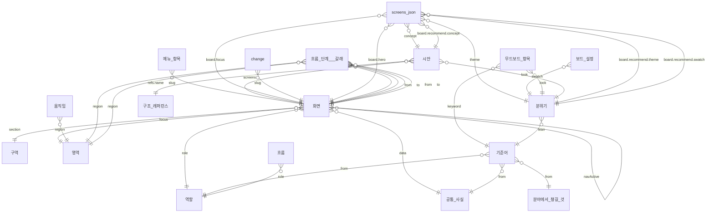

# 객체와 관계 — screens.json · flow.json

> `node scripts/schema.js --docs`가 정본 스키마의 `x-object` · `x-layer` · `x-stage` · `x-ref`에서 만든다. 손으로 고치지 않는다.
> 범위: 문서 전체 · 같은 화면(그 화면의 영역) · 출발 화면(흐름 단계 from의 영역) · 같은 역할(같은 role의 화면) · 고른 분위기(theme의 버튼 색).

## 객체

| 객체 | 정의 | 층 | 생성 단계 | 파일 | 뜻 |
|---|---|---|---|---|---|
| 역할 | `role` | 의도 | S1 의도 | screens.json | 역할 = 사용자 유형. S1 의도 단계에서 쓴다 |
| 목적(분야) | `purpose` ✕ | 의도 | S1 의도 | screens.json | 옛 객체 — 의도 중 사람이 아닌 것(분야). 분야 사실은 facts로 — 다음 판에서 지움 |
| 구역 | `section` | 화면 | S2 여정 · 화면 목록 | screens.json | 구역 하나 — 큰 사용 흐름(처음 시작 · 홈 · 예약 …) |
| 영역 | `region` | 화면 | S3 화면 하나씩 | screens.json | 화면 안 의미 덩어리 하나 |
| 화면 | `screen` | 화면 | S3 화면 하나씩 | screens.json | 화면 하나. id · 이름 · 역할은 S2 화면 목록에서, 내용 설계는 S3에서 화면 하나씩 |
| 움직임 | `motion` | 화면 | S3 화면 하나씩 | screens.json | 움직임 하나 — 종류(type)에 따라 region · trigger가 필요하다 |
| 기준어 | `keyword` | 성격 | S4 성격 | screens.json | 기준어 하나 |
| 무드보드 항목 | `moodItem` | 성격 | S4 성격 | screens.json | 표현용 무드보드 한 칸 — 레퍼런스 하나에서 한 가지 |
| 분위기 | `look` | 성격 | S5 시안 | screens.json | 시안 하나의 분위기 |
| 시안 | `concept` | 성격 | S5 시안 | screens.json | 시안 하나 — 위계 · 모양은 0단계 그대로, 메뉴 틀 · 첫 화면 · 표현만 다르다 |
| 구조 레퍼런스 | `reference` | 성격 | S5 시안 | screens.json | 구조 레퍼런스 — 비슷한 서비스의 첫 화면 · 메뉴 구성 |
| 메뉴 항목 | `navItem` | 화면 | S2 여정 · 화면 목록 | screens.json | 역할 메뉴의 항목 하나 — 화면 하나를 연다 |
| 성격(기준어 · 무드보드) | `mood` | 성격 | S4 성격 | screens.json | ② 성격 — 기준어 · 표현용 무드보드 |
| 공통 사실 | `facts` | 공통 | S1 의도 | screens.json | 이름표(키) → 사실 한 줄 |
| 보드 설정 | `toggles` | 실행 상태 | 하네스 | screens.json | 보드에서 사람이 고른 글자 크기 · 버튼 색 · 안내 문구 모양 — 판단이 아니라 실행 중 값 |
| 분야에서 챙길 것 | `domainItem` ✕ | 의도 | S1 의도 | screens.json | 이 분야에서 꼭 챙길 것 하나 — 기준어 from이 id로 가리킨다 |
| 흐름 단계 · 갈래 | `step` | 화면 | S2 여정 · 화면 목록 | flow.json | 흐름의 한 단계 — 어느 화면의 어느 영역 버튼을 누르면 어느 화면으로. 흐름 밖 버튼(갈래)도 같은 모양 |
| 흐름 | `flow` | 화면 | S2 여정 · 화면 목록 | flow.json | 흐름 하나 — 한 역할이 끊김 없이 이어 가는 작업('~하기') |

## 관계

| 가리키는 객체 | 칸 | 가리키는 곳 | 범위 | 단계 | 대상이 스키마에 있나 |
|---|---|---|---|---|---|
| screens.json | `concept` | `concept.id` | 문서 전체 | 하네스 → S5 시안 | ○ |
| screens.json | `theme` | `look.id` | 문서 전체 | 하네스 → S5 시안 | ○ |
| 보드 설정 | `swatch` | `look.swatches.id` ∪ brand | 고른 분위기 | 하네스 → S5 시안 | ○ |
| 메뉴 항목 | `slug` | `screen.slug` | 같은 역할 | S2 여정 · 화면 목록 → S2 여정 · 화면 목록 | ○ |
| 화면 | `role` | `role.key` | 문서 전체 | S2 여정 · 화면 목록 → S1 의도 | ○ |
| 화면 | `section` | `section.key` | 문서 전체 | S3 화면 하나씩 → S2 여정 · 화면 목록 | ○ |
| 화면 | `variantOf` | `screen.slug` | 같은 역할 | S3 화면 하나씩 → S2 여정 · 화면 목록 | ○ |
| 화면 | `overlayOf` | `screen.slug` | 같은 역할 | S3 화면 하나씩 → S2 여정 · 화면 목록 | ○ |
| 화면 | `navActive` | `screen.slug` | 같은 역할 | S3 화면 하나씩 → S2 여정 · 화면 목록 | ○ |
| 화면 | `data` | `facts.key` | 문서 전체 | S3 화면 하나씩 → S1 의도 | ○ |
| 화면 | `focus` | `region.key` | 같은 화면 | S3 화면 하나씩 → S2 여정 · 화면 목록 | ○ |
| 움직임 | `region` | `region.key` | 같은 화면 | S3 화면 하나씩 → S2 여정 · 화면 목록 | ○ |
| 기준어 | `from` | `role.key` | 문서 전체 | S4 성격 → S1 의도 | ○ |
| 기준어 | `from` | `facts.key` | 문서 전체 | S4 성격 → S1 의도 | ○ |
| 기준어 | `from` | `domainItem.id` ✕ 옛 대상 | 문서 전체 | S4 성격 → S1 의도 | ○ |
| 무드보드 항목 | `keyword` | `keyword.word` | 문서 전체 | S4 성격 → S4 성격 | ○ |
| 무드보드 항목 | `look` | `look.id` | 문서 전체 | S5 시안 → S5 시안 | ○ |
| 분위기 | `lean` | `keyword.word` | 문서 전체 | S5 시안 → S4 성격 | ○ |
| 시안 | `look` | `look.id` | 문서 전체 | S5 시안 → S5 시안 | ○ |
| 시안 | `refs.name` | `reference.name` | 문서 전체 | S5 시안 → S5 시안 | ○ |
| 시안 | `screens` | `screen.slug` | 문서 전체 | S5 시안 → S2 여정 · 화면 목록 | ○ |
| screens.json | `board.recommend.concept` | `concept.id` | 문서 전체 | 하네스 → S5 시안 | ○ |
| screens.json | `board.recommend.theme` | `look.id` | 문서 전체 | 하네스 → S5 시안 | ○ |
| screens.json | `board.recommend.swatch` | `look.swatches.id` ∪ brand | 고른 분위기 | 하네스 → S5 시안 | ○ |
| screens.json | `board.focus` | `screen.slug` | 문서 전체 | 하네스 → S2 여정 · 화면 목록 | ○ |
| change | `slug` | `screen.slug` | 문서 전체 | 하네스 → S2 여정 · 화면 목록 | ○ |
| screens.json | `board.hero` | `screen.slug` | 문서 전체 | 하네스 → S2 여정 · 화면 목록 | ○ |
| 흐름 | `role` | `screens#role.key` | 문서 전체 | S2 여정 · 화면 목록 → S1 의도 | ○ |
| 흐름 단계 · 갈래 | `from` | `screens#screen.slug` | 문서 전체 | S2 여정 · 화면 목록 → S2 여정 · 화면 목록 | ○ |
| 흐름 단계 · 갈래 | `region` | `screens#region.key` | 출발 화면 | S2 여정 · 화면 목록 → S2 여정 · 화면 목록 | ○ |
| 흐름 단계 · 갈래 | `to` | `screens#screen.slug` | 문서 전체 | S2 여정 · 화면 목록 → S2 여정 · 화면 목록 | ○ |
| 흐름 단계 · 갈래 | `from` | `screens#screen.slug` | 문서 전체 | S2 여정 · 화면 목록 → S2 여정 · 화면 목록 | ○ |
| 흐름 단계 · 갈래 | `region` | `screens#region.key` | 출발 화면 | S2 여정 · 화면 목록 → S2 여정 · 화면 목록 | ○ |
| 흐름 단계 · 갈래 | `to` | `screens#screen.slug` | 문서 전체 | S2 여정 · 화면 목록 → S2 여정 · 화면 목록 | ○ |
